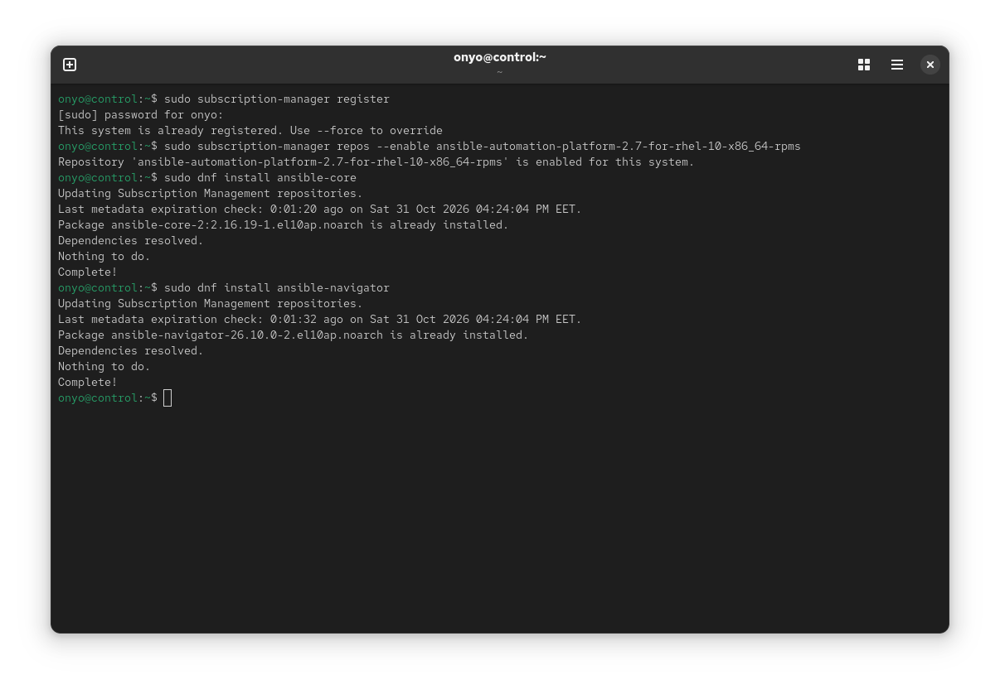
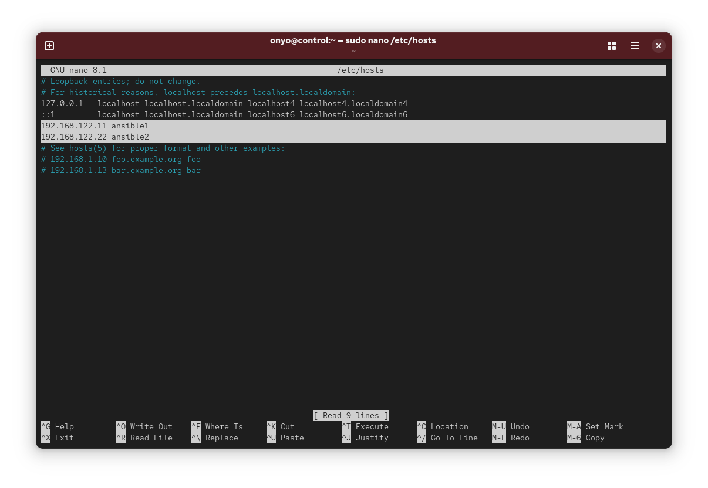
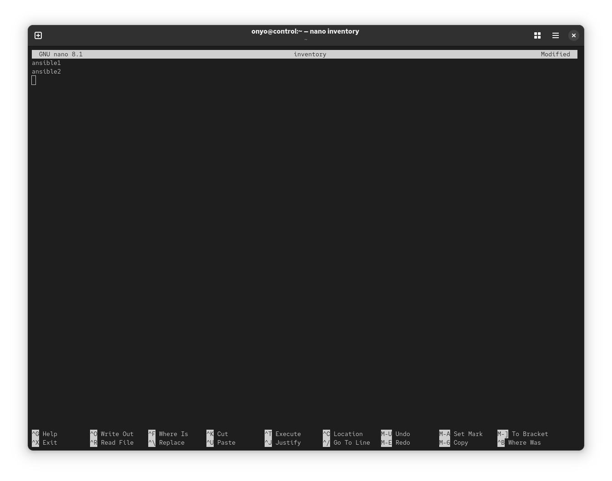
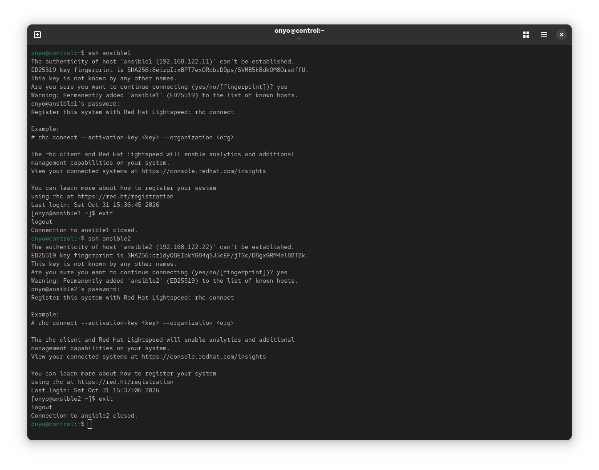
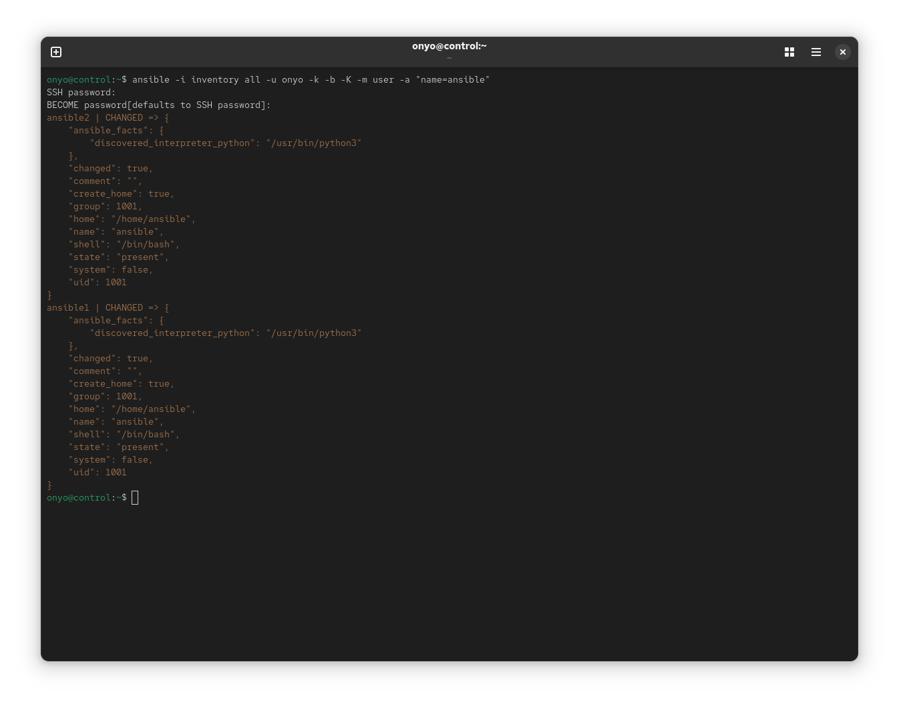
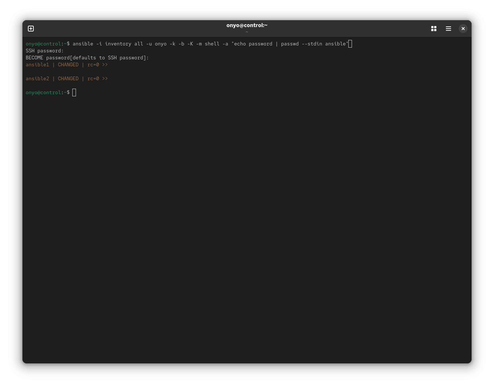
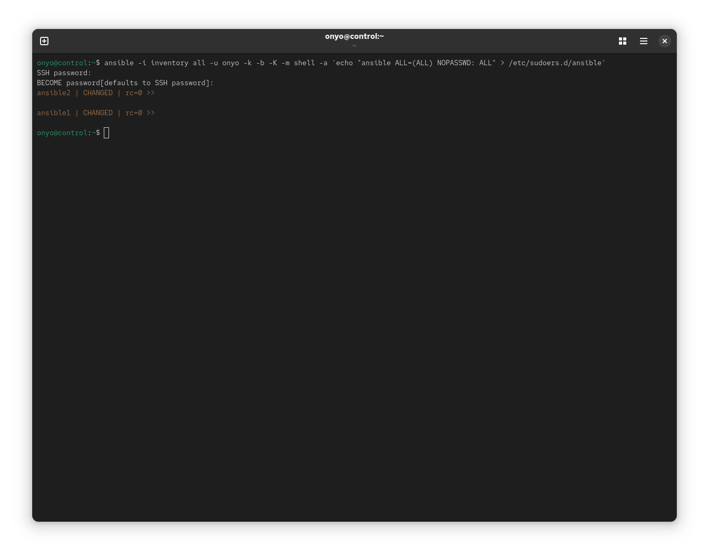
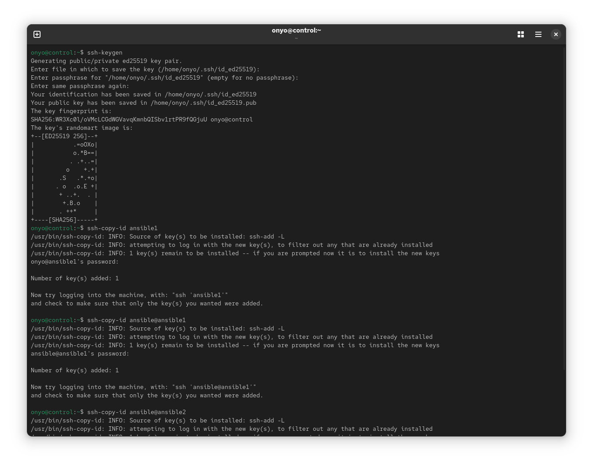
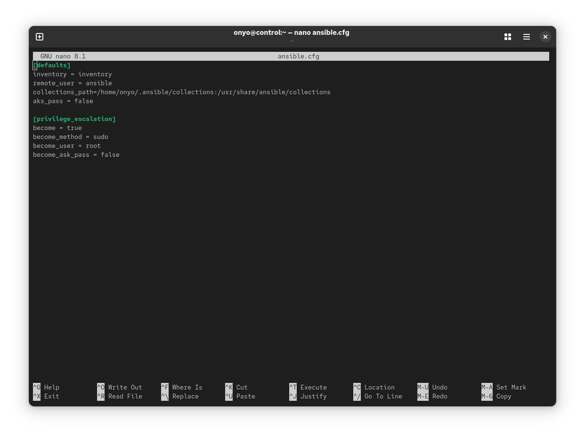
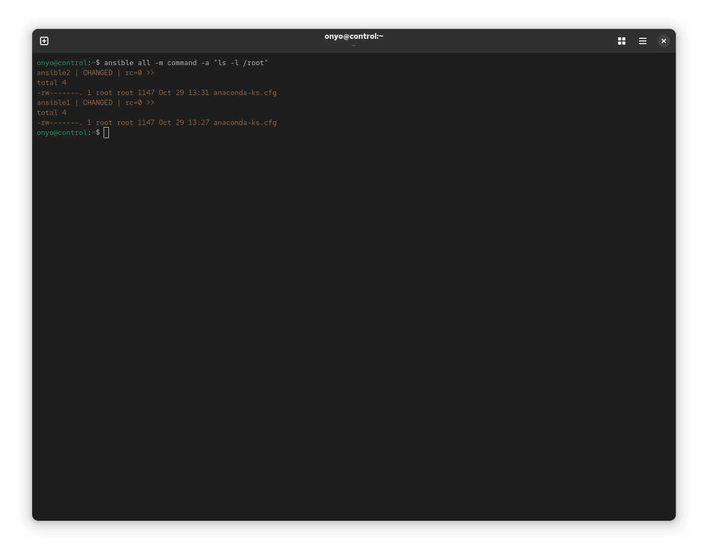

# Lesson 2 Lab: Setting up a Managed Environment

## Task: Configure an Ansible Control Node and Managed Hosts

**Goal:** Finalize setting up the Ansible managed environment ensuring the following requirements are met:

- User `ansible` is used for all management tasks on managed hosts
- Inventory is set up
- `ansible.cfg` is configured for sudo privilege escalation
- SSH key-based login has been configured

---

## Solution

### Step 1: Install Ansible on the control node

Register the system with Red Hat Subscription Manager, enable the Ansible Automation Platform repository, then install `ansible-core` and `ansible-navigator`:

```bash
sudo subscription-manager register
sudo subscription-manager repos --enable ansible-automation-platform-2.7-for-rhel-10-x86_64-rpms
sudo dnf install ansible-core
sudo dnf install ansible-navigator
```

<p align="center">
  
</p>

---

### Step 2: Add managed hosts to `/etc/hosts`

On the control node, add hostname-to-IP mappings for the managed nodes so they can be reached by name:

```bash
sudo nano /etc/hosts
```

Append the following lines:

```text
192.168.122.11 ansible1
192.168.122.22 ansible2
```

<p align="center">
  
</p>

---

### Step 3: Create the inventory file

In the `onyo` user's home directory, create a simple inventory file listing the managed hosts:

```bash
nano ~/inventory
```

**Inventory file: `inventory`**

```ini
ansible1
ansible2
```

<p align="center">
  
</p>

---

### Step 4: Accept SSH host fingerprints

SSH into each managed host once to accept the host key fingerprint and add it to `~/.ssh/known_hosts`. This prevents Ansible from failing on the first connection due to an unknown host key:

```bash
ssh ansible1
exit
ssh ansible2
exit
```

<p align="center">
  
</p>

---

### Step 5: Create the `ansible` user on all managed hosts

Use an ad hoc command to create the `ansible` user on both managed nodes. Since SSH key-based auth is not yet configured for the `ansible` user, connect as the `onyo` user with password prompts enabled (`-k` for SSH password, `-K` for become password):

```bash
ansible -i inventory all -u onyo -k -b -K -m user -a "name=ansible"
```

| Flag | Purpose |
|------|---------|
| `-i inventory` | Specify the inventory file |
| `-u onyo` | Connect as the `onyo` user |
| `-k` | Prompt for SSH password |
| `-b` | Enable privilege escalation (become) |
| `-K` | Prompt for the become (sudo) password |
| `-m user` | Use the `user` module |

<p align="center">
  
</p>

---

### Step 6: Set a password for the `ansible` user on all managed hosts

Set a password for the newly created `ansible` user so SSH key distribution (next step) can authenticate:

```bash
ansible -i inventory all -u onyo -k -b -K -m shell -a "echo password | passwd --stdin ansible"
```

> **Note:** Replace `password` with a secure password in a production environment. The `--stdin` flag reads the password from standard input.

<p align="center">
  
</p>

---

### Step 7: Grant passwordless sudo to the `ansible` user

Create a sudoers drop-in file on each managed host that allows the `ansible` user to run any command as root without a password prompt:

```bash
ansible -i inventory all -u onyo -k -b -K -m shell -a 'echo "ansible ALL=(ALL) NOPASSWD: ALL" > /etc/sudoers.d/ansible'
```

<p align="center">
  
</p>

---

### Step 8: Generate an SSH key pair and distribute it

On the control node, generate an SSH key pair and copy the public key to the `ansible` user on each managed host:

```bash
ssh-keygen
ssh-copy-id ansible@ansible1
ssh-copy-id ansible@ansible2
```

<p align="center">
  
</p>

---

### Step 9: Create the `ansible.cfg` configuration file

In the `onyo` user's home directory, create `ansible.cfg` with the inventory path, remote user, and privilege escalation settings:

```bash
nano ~/ansible.cfg
```

**Configuration file: `ansible.cfg`**

```ini
[defaults]
inventory = inventory
remote_user = ansible
collections_path = /home/onyo/.ansible/collections:/usr/share/ansible/collections
ask_pass = false

[privilege_escalation]
become = true
become_method = sudo
become_user = root
become_ask_pass = false
```

> **Note:** With `remote_user = ansible` and `become = true`, all subsequent Ansible commands will connect as the `ansible` user and automatically escalate to root - no more need for `-u`, `-k`, `-b`, or `-K` flags.

<p align="center">
  
</p>

---

### Step 10: Test privilege escalation

Verify that the `ansible` user can escalate privileges and access root-owned files on the managed hosts:

```bash
ansible all -m command -a "ls -l /root"
```

Both hosts should return `CHANGED` with a listing of `/root`, confirming passwordless SSH login and sudo are working correctly.

<p align="center">
  
</p>

