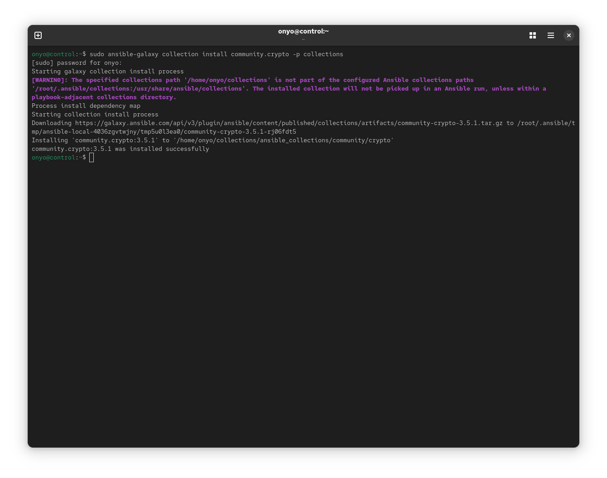
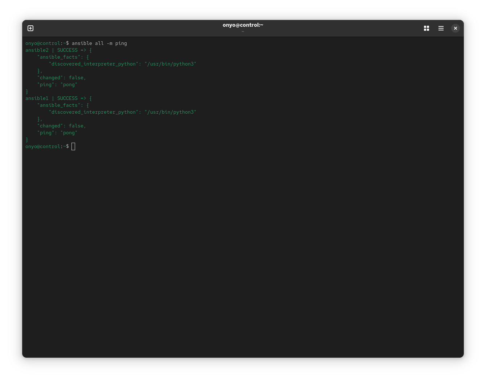
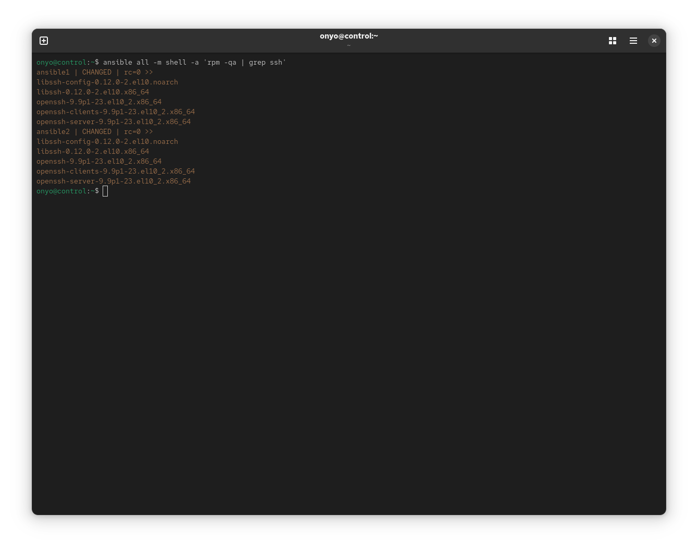

# Lesson 3 Lab: Working with Modules

## Task: Install an Ansible Collection and Use Ad Hoc Commands

**Goal:** Install the `community.crypto` collection so it is available to both `ansible` and `ansible-navigator`, verify managed host connectivity using the `ping` module, and query installed SSH-related RPM packages on all managed nodes using an ad hoc shell command.

---

## Solution

### Step 1: Install the `community.crypto` collection

```bash
ansible-galaxy collection install community.crypto -p collections
```

<p align="center">
  
</p>

---

### Step 2: Ping all managed hosts

Use the `ping` module in an ad hoc command to verify that all hosts in the inventory are reachable and properly configured:

```bash
ansible all -m ping
```

Both `ansible1` and `ansible2` should return `"ping": "pong"` with a `SUCCESS` status, confirming SSH connectivity and Python availability on each node.

<p align="center">
  
</p>

---

### Step 3: Query SSH-related packages on all managed hosts

Use the `shell` module to pipe the output of `rpm -qa` through `grep ssh` on every managed node:

```bash
ansible all -m shell -a 'rpm -qa | grep ssh'
```

> **Note:** The `shell` module (not `command`) is required here because the command uses a pipe (`|`). The `command` module does not process shell operators.

<p align="center">
  
</p>
